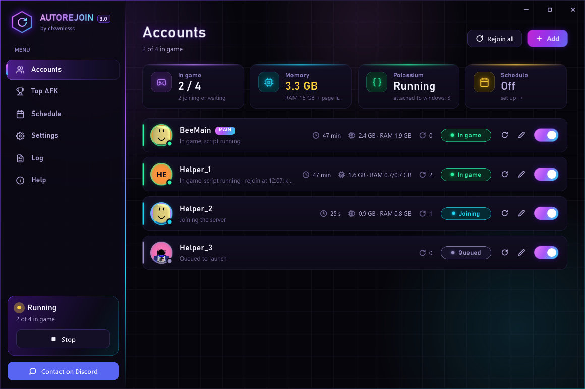

# AutoRejoin

**Owner & developer — [clxwnlessss](https://github.com/clxwnlessss), [wwesse2](https://github.com/wwesse2).**
Contact: Discord **overdosedclxwn** · Community server: **https://discord.gg/bZFB8dwBdw**

Keeps your Roblox **Bee Swarm Simulator** accounts in game 24/7 and rejoins on its own when something goes wrong:
disconnects, kicks, errors, frozen windows, bloated memory or a crashed script. Accounts join strictly one at a time,
main first.



## Download

[Releases](../../releases/latest) → `AutoRejoin.zip` → extract → run `AutoRejoin.exe`. Windows 10/11.

If Windows shows *“Windows protected your PC”*, click **More info → Run anyway** (the app isn't code-signed).
After that it updates itself (Settings → Data → **Check for updates**, plus a silent check on every start).

## Features

- **Auto-rejoin** — watches every window and rejoins on disconnect, kick, error, freeze, memory bloat or a dead script.
- **Strict queue** — the next account launches only after the previous one is in game; the main always goes first.
- **Discord alerts** — a report every 15 minutes, plus instant *🔴 dropped / 🟢 back in game* messages and pings for
  problems that need you (expired cookie, Roblox warning, captcha, Potassium signed out).
- **🏆 Monthly AFK leaderboard** — create an account in the app (or browse as a guest); while your accounts are in
  game, the server counts your AFK hours. A new board every month.
- **Memory control** — restarts bloated windows, waits for free memory, caps helper RAM, page file setup.
- **Scheduled restart** — reboot the PC or rejoin everyone daily at a set time.
- **Stop closes all Roblox windows** until you press Start again.
- **Log cleanup** — old Roblox logs and journals are deleted every 24 hours.
- **English / Russian** interface (defaults to your Windows language).
- **Auto-updates** from GitHub releases.

## What's new

**2.3** — English language: RU/EN switch in Settings → Language.

**2.2** — Monthly AFK leaderboard with accounts, guest mode and a server on Render.

**2.1** — Automatic cleanup of old logs every 24 hours.

**2.0** — Brand-new design (Midnight Violet theme), smooth animations, *Contact on Discord* button, much less text.

## Building from source

Requires .NET SDK 8+ (targets .NET Framework 4.8):

```
dotnet build AutoRejoin.csproj -c Release
```

The app is `bin/Release/net48/AutoRejoin.exe`; `engine.ps1` and `lib/WebView2Loader.dll` must sit next to it.

### Releasing an update

1. Bump the version in `Properties/AssemblyInfo.cs`.
2. Run `.\release.ps1` — it builds and packs `AutoRejoin.zip`.
3. `gh release create vX.Y.Z AutoRejoin.zip --title "AutoRejoin X.Y.Z" --notes "what's new"`.

Every installed copy finds the release and updates itself.

### Leaderboard server

`server/` — Node.js + PostgreSQL. Deploy it on Render with `render.yaml` and set `DATABASE_URL`
(e.g. a free Neon database). Passwords are stored as salted scrypt hashes; the public API exposes only nicknames
and hours. Run the tests with `npm test`.

### Translations

Interface strings live in the code in Russian; English comes from `AutoRejoinApp.lang-en.tsv`
(`russian<TAB>english`, one per line).

## Your data

Cookies, passwords and the webhook URL are stored encrypted (Windows DPAPI) in `%LOCALAPPDATA%\AutoRejoin`,
not in the program folder. Never send that folder to anyone.

## Disclaimer

Automation tools may break Roblox's Terms of Use — use AutoRejoin at your own risk.

---

© clxwnlesss · AutoRejoin
