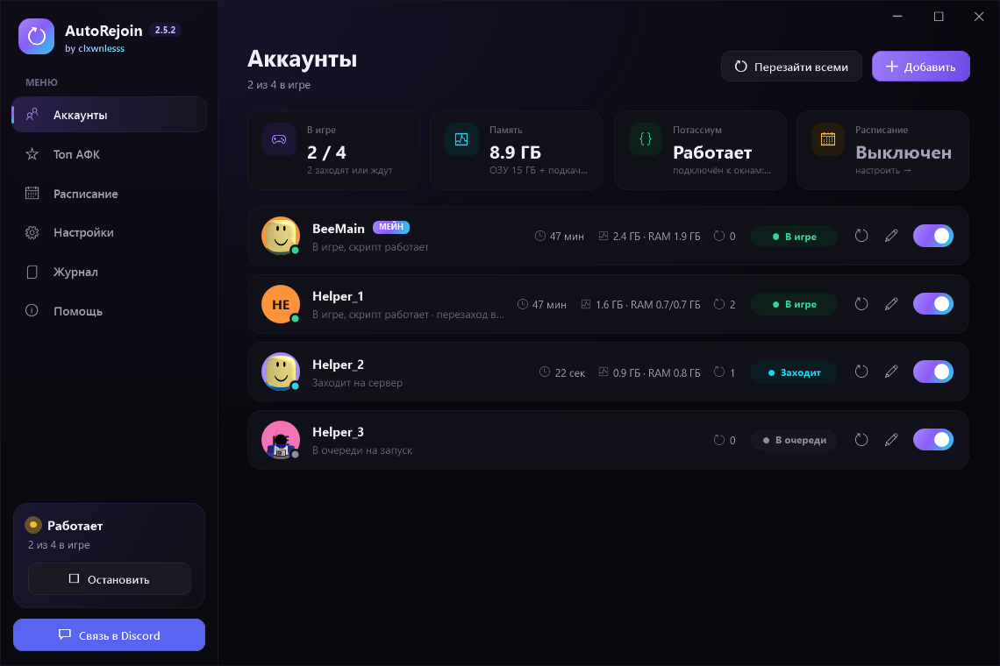

# AutoRejoin 2.0

**Владелец и разработчик — [clxwnlesss](https://discord.com/users/1505693601932382241) (Даниил Арзамасов).**
Связь: Discord **clxwnlesss**.

Держит аккаунты Роблокса (Bee Swarm Simulator) в игре и перезаходит сам: вылет, кик, ошибка, зависание,
раздувшаяся память, упавший скрипт. Аккаунты заходят строго по очереди, мейн первым.

## Скачать

[Releases](../../releases/latest) → `AutoRejoin.zip` → распакуй → `AutoRejoin.exe`. Windows 10/11.
Дальше обновляется сама (Настройки → Данные → «Проверить обновления»).

## Что нового в 2.1

- **Очистка старых логов** раз в 24 часа (срок настраивается): логи Роблокса, журнал AutoRejoin, ошибки.
  Логи открытых окон не трогаются. Кнопка «Очистить сейчас» — Настройки → Данные.

## Что нового в 2.0

- **Новый дизайн** с ног до головы: тёмная тема Midnight Violet, градиенты, новые карточки и меню.
- **Анимации**: появление окна и страниц, карточки аккаунтов выезжают снизу, плавные кнопки, тумблеры с пружиной, пульс индикатора.
- **Кнопка «Связь в Discord»** с владельцем — в боковой панели, в «Помощи» и в настройках.
- **Меньше текста**: подсказки сокращены до сути.

## Возможности

- Отчёт в Discord через вебхук раз в 15 минут и мгновенные оповещения о вылетах и проблемах.
- «Остановить» закрывает все окна Роблокса до нажатия «Запустить».
- Пауза между аккаунтами, плановый перезапуск, контроль памяти, работа с Потассиумом.
- Автообновление с GitHub.

## Сборка

Нужен .NET SDK 8+ (собирается под .NET Framework 4.8): `dotnet build AutoRejoin.csproj -c Release`.

## Выпуск обновления

1. Подними версию в `Properties/AssemblyInfo.cs`.
2. `.\release.ps1` — соберёт `AutoRejoin.zip`.
3. `gh release create vX.Y.Z AutoRejoin.zip --title "AutoRejoin X.Y.Z" --notes "что нового"`.

## Данные

Куки, пароли и вебхук хранятся зашифрованными (Windows DPAPI) в `%LOCALAPPDATA%\AutoRejoin`. Никому не отправляй эту папку.

---

© clxwnlesss · AutoRejoin
